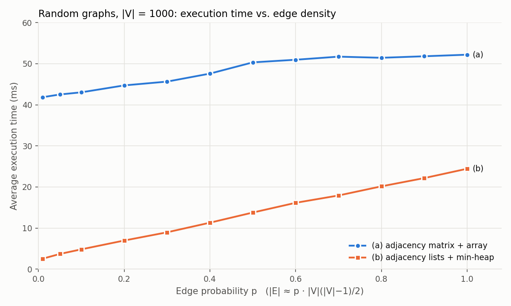
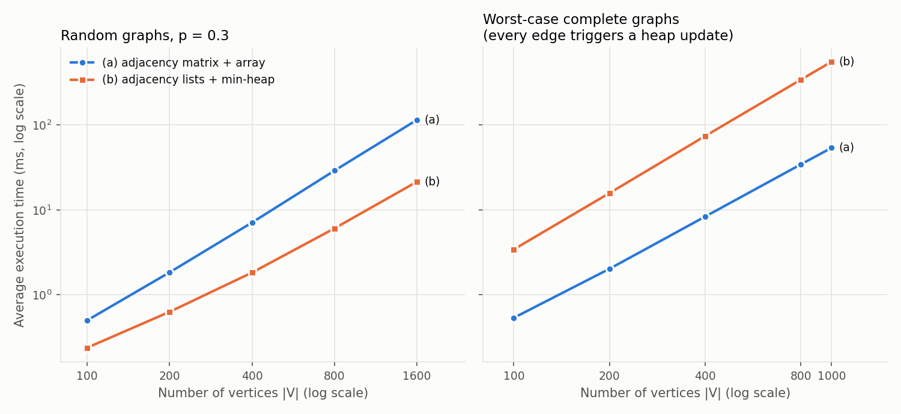

# SC2001 Project 2: Dijkstra's Algorithm

## Part (c): Comparison of Implementations (a) and (b)

This part has no implementation of its own. It compares:

- **(a)** an adjacency matrix with an array-scan priority queue (`project2_part_a/dijkstra_array.py`), and
- **(b)** an array of adjacency lists with a binary min-heap priority queue (`project2_part_b/dijkstra_heap.py`).

`experiment.py` in this folder imports both implementations directly and times them on the same graphs, in the same script run, on one machine. `plot_results.py` produces the plots from `results.csv`. The raw console output is saved in `experiment_output.txt`.

### 1. Summary of Theoretical Comparison

| | (a) Matrix + array | (b) Adjacency lists + min-heap |
|---|---|---|
| Selecting the next vertex | O(\|V\|) scan, done \|V\| times: O(\|V\|²) | O(log \|V\|) `extract_min`, done \|V\| times: O(\|V\| log \|V\|) |
| Relaxing edges | Scans a full matrix row per vertex: O(\|V\|²), whether or not the edges exist | Scans only existing edges: O(\|E\|), plus O(log \|V\|) per `decrease_key` |
| Worst-case time | **O(\|V\|²)** | **O((\|V\| + \|E\|) log \|V\|)** |
| Sparse graph, \|E\| = O(\|V\|) | O(\|V\|²) | O(\|V\| log \|V\|) |
| Dense graph, \|E\| = Θ(\|V\|²) | O(\|V\|²) | O(\|V\|² log \|V\|) |
| Space | O(\|V\|²) | O(\|V\| + \|E\|) |

The two bounds are equal when (|V| + |E|) log |V| ≈ |V|², that is, when |E| ≈ |V|² / log |V|. Below that density (b) has the better bound; above it (a) does. For |V| = 1000, |V|² / log₂|V| ≈ 100,000 edges, which is an edge probability of about 0.2.

This is a statement about **worst cases only**. The O(|E| log |V|) term in (b) assumes that every edge examination triggers a `decrease_key`. Part (b)'s operation counts showed that random graphs come nowhere near this: at |V| = 1000 and about 400,000 edges, only about 2,300 relaxations improved a distance. In a typical run, (b) does O(|E|) cheap edge checks plus far fewer heap operations, so it behaves more like O(|E| + |V| log |V|). That is never worse than (a)'s O(|V|²), because |E| ≤ |V|²/2. Where the two implementations cross over therefore depends on how many edges trigger a heap update, not only on how dense the graph is. The experiments below test both cases.

### 2. Summary of Empirical Comparison

#### 2.1 Results from parts (a) and (b)

Both teammates used the same graph generator: random undirected graphs, edge probability 0.3, integer weights 1–20, `random.seed(42)`, and the average of five runs. For the same seed they produced exactly the same graphs.

| \|V\| | \|E\| | (a) Nurgepi's machine (s) | (a) Lakshya's machine (s) | (b) Lakshya's machine (s) |
|---:|---:|---:|---:|---:|
| 100 | 1,462 | 0.002421 | – | 0.000492 |
| 200 | 5,966 | 0.006711 | – | 0.001293 |
| 400 | 23,909 | 0.018556 | – | 0.003635 |
| 800 | 95,824 | 0.073862 | 0.055 | 0.012092 |

Two things limit how far these numbers can be compared:

1. **The timings come from different machines.** The same (a) run on the same graph took 0.074 s on one machine and 0.055 s on the other, a 34% difference that has nothing to do with the algorithm. The same issue came up in Project 1.
2. **Each part tested only part of the space.** Part (a) varied only |V| (at p = 0.3). Part (b) also varied the edge probability at |V| = 1000, but only for the heap implementation. Neither part ran both implementations across a range of densities, which is the experiment that tests the claim in Section 1 that (a) should win on dense graphs.

#### 2.2 Same-machine experiment

All timings below come from one run of `project2_part_c/experiment.py` on one machine (Apple M4, Python 3.13.6). The setup matches parts (a) and (b):

- **Graphs:** the same generator. Experiments 1 and 2 call `random.seed(42)` at the start, as part (b) did. As a check, the first four graphs in Experiment 1 have exactly the edge counts reported in parts (a) and (b), so they are the same graphs.
- **Representations:** each graph is built as a matrix for (a) and converted to adjacency lists for (b), as in part (b). The conversion is not timed.
- **Timing:** `time.perf_counter()`, averaged over five repetitions. The two implementations alternate within each repetition, so both run under the same machine conditions.
- **Correctness:** every timed run asserts that (a) and (b) return identical distance arrays.
- **Heap operation counts:** for each graph, (b) is run once more, untimed, with a subclass of `MinHeap` that counts calls to `insert` and `decrease_key`.

The "a / b" column is (a)'s time divided by (b)'s time. A value above 1 means (b) is faster.

**Experiment 1: varying |V| (edge probability = 0.3)**

| \|V\| | \|E\| | (a) array (s) | (b) heap (s) | a / b | decrease-keys in (b) |
|---:|---:|---:|---:|---:|---:|
| 100 | 1,462 | 0.000502 | 0.000239 | 2.10 | 128 |
| 200 | 5,966 | 0.001842 | 0.000632 | 2.92 | 361 |
| 400 | 23,909 | 0.007107 | 0.001831 | 3.88 | 763 |
| 800 | 95,824 | 0.029006 | 0.006067 | 4.78 | 1,712 |
| 1600 | 384,004 | 0.114654 | 0.021468 | 5.34 | 3,425 |

This machine is faster in absolute terms than both teammates' machines: (a) took 0.029 s at |V| = 800, against 0.074 s and 0.055 s. The **ratio**, however, is close to Lakshya's same-machine result: 4.78 here and 0.055 / 0.0121 = 4.56 there. Absolute timings do not carry over between machines, but the relative comparison does. At p = 0.3, (b) is faster at every size, and its lead grows with |V|.

**Experiment 2: varying edge probability (|V| = 1000)**

| Edge probability | \|E\| | (a) array (s) | (b) heap (s) | a / b | decrease-keys in (b) |
|---:|---:|---:|---:|---:|---:|
| 0.01 | 5,010 | 0.041857 | 0.002562 | 16.33 | 850 |
| 0.05 | 24,961 | 0.042518 | 0.003707 | 11.47 | 1,732 |
| 0.1 | 49,675 | 0.043041 | 0.004828 | 8.92 | 1,987 |
| 0.2 | 100,242 | 0.044726 | 0.006972 | 6.41 | 2,022 |
| 0.3 | 150,274 | 0.045649 | 0.008973 | 5.09 | 2,201 |
| 0.4 | 200,086 | 0.047597 | 0.011313 | 4.21 | 2,207 |
| 0.5 | 249,890 | 0.050329 | 0.013782 | 3.65 | 2,165 |
| 0.6 | 298,966 | 0.050969 | 0.016151 | 3.16 | 2,163 |
| 0.7 | 349,788 | 0.051723 | 0.017934 | 2.88 | 2,180 |
| 0.8 | 399,642 | 0.051445 | 0.020159 | 2.55 | 2,279 |
| 0.9 | 449,370 | 0.051815 | 0.022167 | 2.34 | 2,347 |
| 1.0 | 499,500 | 0.052197 | 0.024442 | 2.14 | 2,378 |

**There is no density crossover on random graphs.** (b)'s lead shrinks steadily as the graph gets denser, from 16× at p = 0.01 to 2.1× on the complete graph, but (b) stays faster even at p = 1.0. The theoretical crossover at p ≈ 0.2 from Section 1 does not appear.

The two curves show why:

- **(a) is almost flat.** Its time rises only 25%, from 42 ms to 52 ms, while |E| grows 100 times. Its cost is dominated by the two O(|V|) scans per vertex, which run whether or not edges exist. The small rise comes from the relaxation arithmetic, which only runs when `graph[u][v] != 0`.
- **(b) is linear in |E|.** Its time grows from 2.6 ms to 24.4 ms, about 44 ns per extra edge. Meanwhile the number of `decrease_key` calls stays at about 2,000 from p = 0.1 upwards. Dense random graphs therefore add cheap edge checks, not expensive heap operations.

For (b) to reach (a)'s 52 ms on random graphs at |V| = 1000, the line would have to continue to about 1.1 million edges. A simple graph with 1000 vertices can have at most 499,500.

**Experiment 3: worst-case complete graphs**

Experiment 2 never reaches the worst case for (b), because random weights almost never trigger `decrease_key`. To test the theoretical worst case directly, `generate_worst_case_graph(n)` builds a complete graph with these weights (no randomness is involved, so no seed is needed):

- Edge (i, i+1) has weight 1, so the shortest distance to v is v, and vertices are extracted in the order 0, 1, …, |V|−1.
- Every other edge (i, j), with j > i+1, has weight |V|·(|V|−i) − j − i. Then dist[i] + w(i, j) = |V|·(|V|−i) − j, which is strictly smaller than the tentative distance any earlier vertex gave j.

As a result, every time a vertex is extracted, every unvisited vertex gets an `insert` or a `decrease_key`, which totals |V|(|V|−1)/2 heap updates. The counts below confirm this: decrease-keys = |E| − (|V| − 1).

| \|V\| | \|E\| | (a) array (s) | (b) heap (s) | a / b | decrease-keys in (b) |
|---:|---:|---:|---:|---:|---:|
| 100 | 4,950 | 0.000537 | 0.003432 | 0.16 | 4,851 |
| 200 | 19,900 | 0.002027 | 0.015779 | 0.13 | 19,701 |
| 400 | 79,800 | 0.008343 | 0.073960 | 0.11 | 79,401 |
| 800 | 319,600 | 0.034308 | 0.340926 | 0.10 | 318,801 |
| 1000 | 499,500 | 0.053789 | 0.554662 | 0.10 | 498,501 |

**Here (a) wins clearly, by about 10× at |V| ≥ 800.** (a)'s time is nearly the same as on the random complete graph in Experiment 2 (0.0538 s vs. 0.0522 s at |V| = 1000), which confirms that (a) does not depend on the edge weights. (b)'s time, by contrast, is 23× its random complete-graph time.

The growth rates also match the theory. From |V| = 400 to 800, (a)'s time grows by a factor of 4.11 (|V|² predicts 4). (b)'s time grows by 4.61, and |V|² log |V| predicts 4 × log 800 / log 400 = 4.46. The a / b ratio falls slowly as |V| grows (0.16 → 0.10), which is the extra log |V| factor appearing.

#### 2.3 Where the crossover lies

Experiments 2 and 3 are two ends of a range for dense graphs. At |V| = 1000 with all 499,500 edges present, (b) took 24.4 ms with 2,378 decrease-keys and 554.7 ms with 498,501. Interpolating linearly between the two, each extra `decrease_key` costs about 1.07 µs. (b) would match (a)'s 52 ms at about 28,000 decrease-keys, which is **roughly 6% of the edges**. This crossover is an estimate from two measured endpoints, not a measured point. Even so, it shows the condition that matters: on a dense graph, (a) wins once more than a small fraction of edge examinations lead to a heap update.

### 3. Discussion: Which Implementation Is Better, and When

**Neither implementation is better in every case. The answer depends on how dense the graph is and how often relaxations improve a distance.**

**(b) is better for sparse and moderately dense graphs, and for most typical inputs.** This is where its theoretical advantage is largest: O(|V| log |V|) against O(|V|²) when |E| = O(|V|). At p = 0.01 it was 16× faster. Many real graphs, such as road networks, computer networks and social graphs, are sparse, with average degree far below |V|. (b) also uses O(|V| + |E|) memory instead of O(|V|²). For large sparse graphs this matters as much as speed: a matrix for 100,000 vertices would have 10¹⁰ entries.

**(b) also won on dense random graphs, even though theory favours (a) there.** The O(|V|² log |V|) bound for dense graphs assumes every edge triggers a `decrease_key`. With random weights, only a few thousand did, so (b)'s cost was dominated by O(1) edge checks. That is roughly O(|V|²) on a complete graph, the same order as (a). With equal growth rates, the constant factor decides. (a) performs two passes over |V| entries per vertex (the minimum scan and the row scan), while (b) makes one pass over the vertex's neighbours, so (b) remains about 2× faster even at p = 1.0.

**(a) is better when the graph is dense and many relaxations succeed.** This holds whenever |E| is close to |V|² and a large share of edges lower a tentative distance. Experiment 3 constructs this case, and (a) was 10× faster. On dense graphs, the estimate in Section 2.3 puts the break-even point at about 6% of edges triggering a `decrease_key`. Graphs where distances keep improving include weights with structure, such as a long cheap path with expensive shortcuts. They are less common than random-weight graphs, but they are the worst case that the theory accounts for.

**(a) is also the safer choice when consistent running time matters.** Experiments 2 and 3 show that (a)'s time depends only on |V|: it ranged from 42 to 54 ms at |V| = 1000 across every graph tested, regardless of edges or weights. (b) ranged from 2.6 ms to 555 ms on graphs of the same size. If the inputs are dense and the edge weights are not known in advance, (a)'s O(|V|²) is a guarantee, while (b)'s good dense-graph performance depends on the input.

**Other practical factors:**

- **Simplicity.** (a) needs no extra data structure. (b) needs a heap with a position array to support `decrease_key` in O(log |V|).
- **Graph format.** If the input already arrives as a matrix (for example, a distance table between cities), (a) can use it directly. (b) would first need an O(|V|²) conversion, which these experiments did not time.
- **Memory on dense graphs.** Asymptotically, adjacency lists never use more space than a matrix. In Python, however, each adjacency-list entry is a `(v, weight)` tuple, so on a complete graph the lists take more memory than the matrix of integers.

**Summary of when to use each:**

| Situation | Better choice | Evidence |
|---|---|---|
| Sparse graph (\|E\| much smaller than \|V\|²) | **(b)** | 16× faster at p = 0.01, \|V\| = 1000 |
| Moderate density, typical or random weights | **(b)** | 3–9× faster for p = 0.1–0.5 |
| Dense graph, random weights (few successful relaxations) | **(b)**, by a smaller margin | 2.1× faster even on the complete graph |
| Dense graph, many successful relaxations | **(a)** | 10× faster on worst-case complete graphs |
| Dense graph, worst-case guarantee needed | **(a)** | Same running time regardless of weights |
| Very large graph, memory-limited | **(b)** | O(\|V\| + \|E\|) space vs. O(\|V\|²) |

In conclusion, (b) is the better general-purpose implementation. It is asymptotically faster on sparse graphs, and in practice it stayed faster on dense random graphs because few relaxations trigger heap updates. (a) is better only for dense graphs, either where many relaxations succeed or where a predictable O(|V|²) bound that does not depend on the input is needed. The density crossover predicted by the worst-case bounds is real, as Experiment 3 shows. However, it occurs only when the input forces many `decrease_key` operations, not on dense graphs in general.

As in parts (a) and (b), the absolute timings depend on the hardware used. Running both implementations in the same script run removes cross-machine differences from the comparison but does not make the numbers apply to other machines. The ratios between (a) and (b), and the trends across |V| and density, are the results that carry over. The random graph generator does not guarantee connectivity, but in Experiment 2 all 1,000 vertices were reachable from the source even in the sparsest graph (p = 0.01). Neither implementation stopped early.
