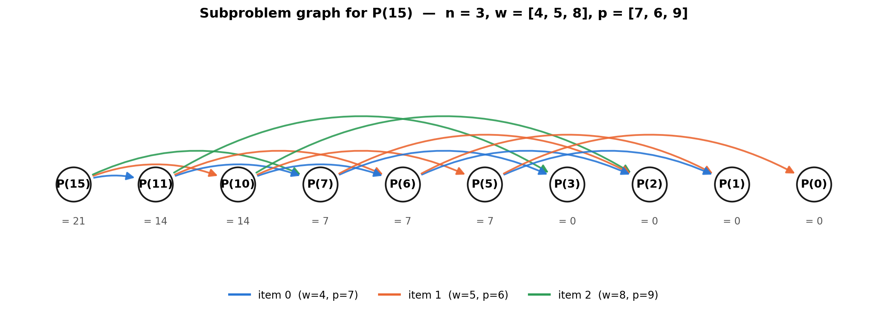

# SC2001 Project 3: Dynamic Programming

## Part 1: Recursive Definition of P(C)

### Problem Recap

We are given a knapsack of capacity `C` and `n` types of objects, where object type `i` has weight `w_i` and profit `p_i` (all positive integers), with an unlimited supply of every type. `P(C)` denotes the maximum total profit obtainable by packing objects into a knapsack of capacity `C`.

### Recursive Definition

```
P(0) = 0

P(C) = max( { p_i + P(C - w_i)  :  0 <= i <= n-1  and  w_i <= C } )   , for C > 0,
             provided at least one w_i <= C

P(C) = 0                                                              , for C > 0,
             if w_i > C for every i  (no object fits)
```

Equivalently, folding the empty-set case into the maximum:

```
P(C) = max( { 0 } ∪ { p_i + P(C - w_i) : 0 <= i <= n-1, w_i <= C } )   for all C >= 0
```

### Justification (Optimal Substructure)

Consider an optimal packing for capacity `C > 0` that attains `P(C)`. Since every `w_i > 0`, if at least one object fits, no optimal solution can be empty (adding an object that fits never decreases profit, because all profits are positive). So an optimal solution for `C` includes at least one unit of some object type `i`, where `w_i <= C`.

Remove one unit of that type `i` from the solution. What remains is a packing of the remaining capacity `C - w_i`, using the same `n` object types with the same unlimited supply (removing one unit of type `i` does not use up its supply, since supply is unlimited). This remaining packing must itself be optimal for capacity `C - w_i` — if a better packing of `C - w_i` existed, adding one more unit of type `i` back to it would produce a packing of `C` with higher profit than `p_i + P(C - w_i)`, contradicting the optimality of the original solution. This is the optimal-substructure property: an optimal solution to `P(C)` is built from an optimal solution to a smaller subproblem `P(C - w_i)`.

Since we do not know in advance which object type `i` was used last, the recurrence tries every type whose weight fits in `C`, solves the resulting subproblem `P(C - w_i)` optimally, and keeps the best of the `n` choices. The base case `P(0) = 0` reflects a knapsack with no remaining capacity, which can hold nothing.

---

## Part 2: Subproblem Graph for P(15)

### Setup

For this instance, `n = 3` and `C = 15`, with the weights and profits given in the brief:

| | 0 | 1 | 2 |
|---|---:|---:|---:|
| w_i | 4 | 5 | 8 |
| p_i | 7 | 6 | 9 |

### Constructing the Graph

Each node in the subproblem graph is a distinct value of `C` that the recursion in Part 1 can reach, starting from `P(15)`. A directed edge `P(C) -> P(C - w_i)` is drawn whenever object type `i` fits in capacity `C` (i.e. `w_i <= C`), since computing `P(C)` directly depends on the value of `P(C - w_i)`. Starting from `P(15)` and repeatedly subtracting `w_0 = 4`, `w_1 = 5`, and `w_2 = 8` (whenever the result stays non-negative) reaches every subproblem that the top-down recursion for `P(15)` would ever call.

### Result

Only **10 distinct subproblems** are reachable from `P(15)`, connected by **15 edges**:

`P(15), P(11), P(10), P(7), P(6), P(5), P(3), P(2), P(1), P(0)`



| From | To (item 0, w=4) | To (item 1, w=5) | To (item 2, w=8) |
|---:|:---:|:---:|:---:|
| P(15) | P(11) | P(10) | P(7) |
| P(11) | P(7) | P(6) | P(3) |
| P(10) | P(6) | P(5) | P(2) |
| P(7) | P(3) | P(2) | — (7 − 8 < 0) |
| P(6) | P(2) | P(1) | — (6 − 8 < 0) |
| P(5) | P(1) | P(0) | — (5 − 8 < 0) |
| P(3), P(2), P(1), P(0) | — | — | — (below every w_i, or the base case) |

`P(3)`, `P(2)`, and `P(1)` are leaves: every `w_i > C` there, so `P(C) = 0` directly by the second case of the recurrence, with no further subproblem calls. `P(0)` is the base case and is likewise a leaf.

A naive recursive implementation of Part 1's recurrence, called directly on `P(15)`, would re-derive many of these subproblems repeatedly — for example, `P(6)` is reachable from both `P(11)` and `P(10)`, and `P(2)` is reachable from three different parents (`P(10)`, `P(7)`, and `P(6)`). This overlap is exactly the second hallmark of a dynamic-programming problem (the first being optimal substructure, shown in Part 1): the recursion tree for `P(15)` is exponential in size, but the subproblem *graph* collapses it to only 10 distinct nodes. Part 3's bottom-up algorithm exploits this by solving each of these 10 subproblems exactly once, in order of increasing `C`, and storing each result for reuse — which is also why the diagram above only needs 10 nodes rather than the much larger recursion tree it is folded from.
